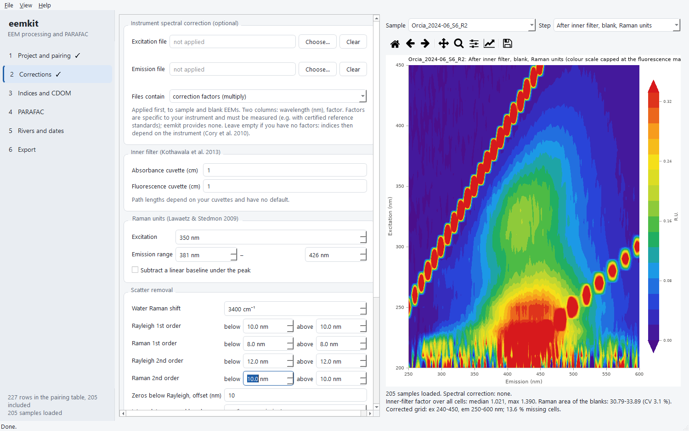

# eemkit

[](https://github.com/LowCostSensor/eemkit/actions/workflows/tests.yml)
[](https://lowcostsensor.github.io/eemkit/)
[](https://pypi.org/project/eemkit/)
[](https://doi.org/10.5281/zenodo.23982732)
[](https://github.com/LowCostSensor/eemkit/blob/main/LICENSE)

Python tools and a desktop application for fluorescence excitation-emission
matrices (EEMs) of dissolved organic matter: instrument import, corrections,
fluorescence indices and validated PARAFAC modelling, with every processing
step recorded so that an analysis can be repeated exactly.



## What it does

* **Import** Agilent Cary Eclipse 3-D EEMs and Cary 60 absorbance spectra
  (CSV "ASCII with log"), with the instrument settings from the file log;
  also Horiba Aqualog and Fluoromax, Hitachi F-7000, Shimadzu and plain
  matrix or two-column files. Processing already done by the instrument
  software must be declared and is never repeated.
  Samples, blanks and absorbance spectra are paired through an explicit,
  hand-editable table: nothing is matched silently.
* **Correct** in a fixed, enforced order: instrument spectral correction
  (optional), absorbance blank, inner-filter effect (Kothawala et al. 2013),
  blank subtraction, Raman units (Lawaetz & Stedmon 2009), Rayleigh and Raman
  scatter removal, crop. Values that depend on the measurement, such as cuvette
  path lengths, have no defaults.
* **Indices**: fluorescence index, humification and biological indices, Coble
  peaks.
* **CDOM metrics** from the absorbance spectra: a254, a350, spectral slopes
  S275–295 and S350–400, slope ratio (Helms et al. 2008), E2:E3 and SUVA254,
  after a baseline correction; values the signal cannot support are left
  empty with the reason.
* **PARAFAC** with non-negativity and missing values, random starts, core
  consistency, leverage and residuals, split-half validation (Murphy et al.
  2013) and export to OpenFluor.
* **Rivers, sites and dates**: any index, CDOM metric or PARAFAC component
  compared between sampling campaigns within each river (replicates averaged
  per site, Kruskal–Wallis and Dunn tests), along the river and against
  covariates such as discharge or rainfall, with a warning when rivers and
  dates cannot be separated.
* **Figures** for publication, and a **desktop application** (PySide6, light
  and dark themes) that drives the whole chain without code.
* **Provenance**: data are `xarray` datasets that carry their metadata and the
  full processing history; one settings file drives both scripts and the
  application.

## Install

You need Python 3.11 or later (on Windows, tick *Add python.exe to PATH* when
installing it). The `[gui]` part adds the desktop application and the
figures:

```bash
python -m pip install "eemkit[gui]"
```

Then start the application with:

```bash
python -m eemkit.gui
```

For the library alone, leave out `[gui]` (or use `[plot]` for figures
without the application). A stand-alone Windows build of the application,
which needs no Python, is attached to each
[release](https://github.com/LowCostSensor/eemkit/releases).

To update to the latest release:

```bash
python -m pip install --upgrade "eemkit[gui]"
```

The development version, with changes not yet released, installs from GitHub:

```bash
python -m pip install --force-reinstall "eemkit[gui] @ https://github.com/LowCostSensor/eemkit/archive/refs/heads/main.zip"
```

`python -m pip show eemkit` tells which version is installed; the changes of
each version are in the
[changelog](https://github.com/LowCostSensor/eemkit/blob/main/CHANGELOG.md).

## Quick start

```python
from eemkit import pipeline

s = pipeline.load_settings("project.toml")    # data folder, pairing table, parameters
raw = pipeline.load(s, base=".")
after_raman = pipeline.correct_until_raman(raw, s, base=".")
corrected = pipeline.finish_corrections(after_raman, s)
indices = pipeline.compute_indices(after_raman, s)

ds = pipeline.parafac_input(corrected, s)
exploration = pipeline.explore(ds, s)          # 2..7 components, split-half validation
model, split = pipeline.fit_final(ds, s)       # the number of components you chose
pipeline.export_results("results", s, corrected=corrected, indices=indices,
                        exploration=exploration, model=model, split=split)
```

Or start the application (`python -m eemkit.gui`) and open the same
`project.toml`, or run it from a terminal:

```bash
eemkit check project.toml    # missing files and settings
eemkit run project.toml      # the whole chain, results in project.output_dir
```

Every function can also be used on its own; see the
[documentation](https://lowcostsensor.github.io/eemkit/).

## Validation

On 205 river-water samples (Ombrone basin, Italy; Polvani et al. 2026) eemkit
was compared with the R package staRdom 1.1.32 (Pucher et al. 2019):

* corrected EEMs agree to a median relative difference of 2.2 × 10⁻⁴ (the
  remainder is the numerical integration of the Raman area);
* FI, BIX and Coble peaks agree to machine precision, HIX to 3 × 10⁻⁴;
* the 3-component PARAFAC models have Tucker congruence ≥ 0.999 for every
  excitation and emission loading.

The scripts and the full report are in
[ombrone-fdom](https://github.com/LowCostSensor/ombrone-fdom).

## Development

```bash
git clone https://github.com/LowCostSensor/eemkit
cd eemkit
pip install -e ".[dev]"
pytest
```

Tests that need the real dataset are skipped unless `EEMKIT_TEST_DATA` points
to its root folder. Contributions and bug reports are welcome: see
[CONTRIBUTING.md](https://github.com/LowCostSensor/eemkit/blob/main/CONTRIBUTING.md).

## Citation

If you use eemkit, please cite it, together with the methods it implements
(listed in the documentation of each step):

> Cirrone, R. G. eemkit: EEM processing and PARAFAC modelling of dissolved
> organic matter fluorescence. Zenodo.
> [doi:10.5281/zenodo.23982732](https://doi.org/10.5281/zenodo.23982732)

This DOI always points to the latest version; each release also has its own
DOI, listed on the Zenodo page (0.1.0:
[10.5281/zenodo.23982733](https://doi.org/10.5281/zenodo.23982733)). The
details are in
[CITATION.cff](https://github.com/LowCostSensor/eemkit/blob/main/CITATION.cff).

## License

GNU General Public License v3.0 or later. See
[LICENSE](https://github.com/LowCostSensor/eemkit/blob/main/LICENSE).

## References

Kothawala et al. (2013) *Limnol. Oceanogr. Methods* 11, 616–630 ·
Lawaetz & Stedmon (2009) *Appl. Spectrosc.* 63, 936–940 ·
Murphy et al. (2013) *Anal. Methods* 5, 6557–6566 ·
Polvani et al. (2026) *Environ. Pollut.* 396, 127858 ·
Pucher et al. (2019) *Water* 11, 2366.
