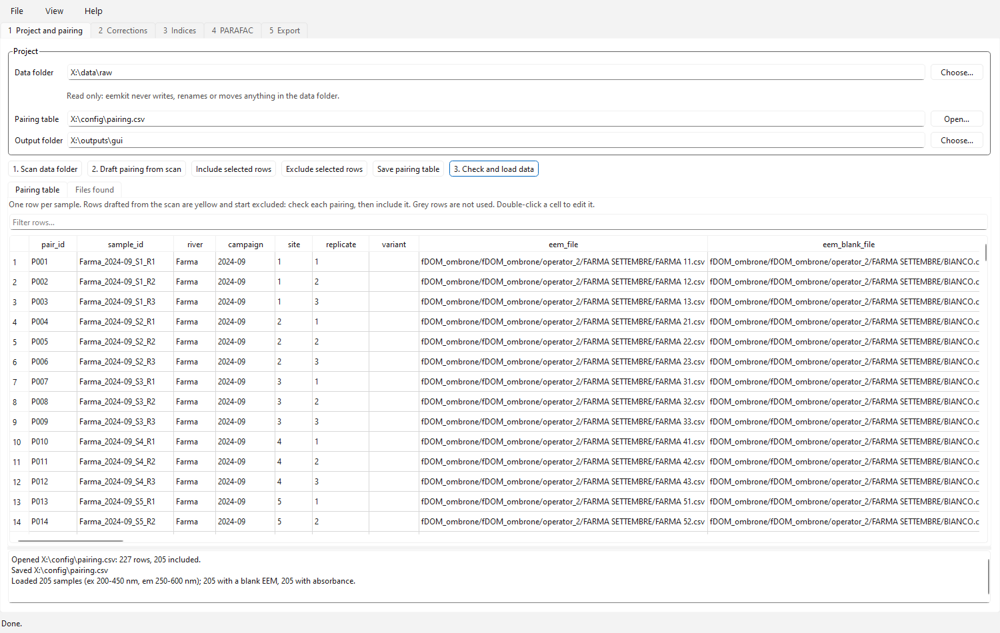
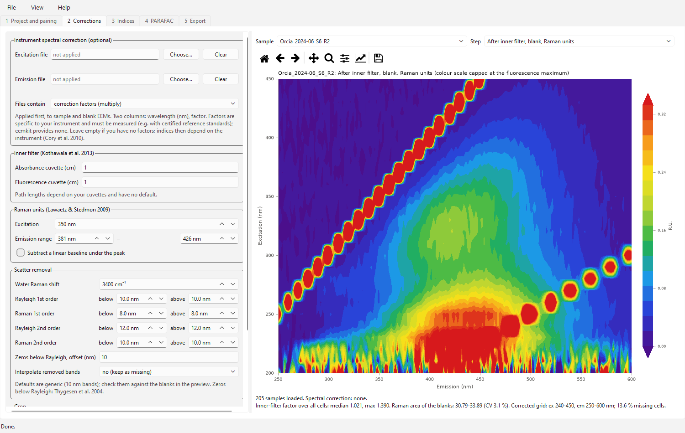
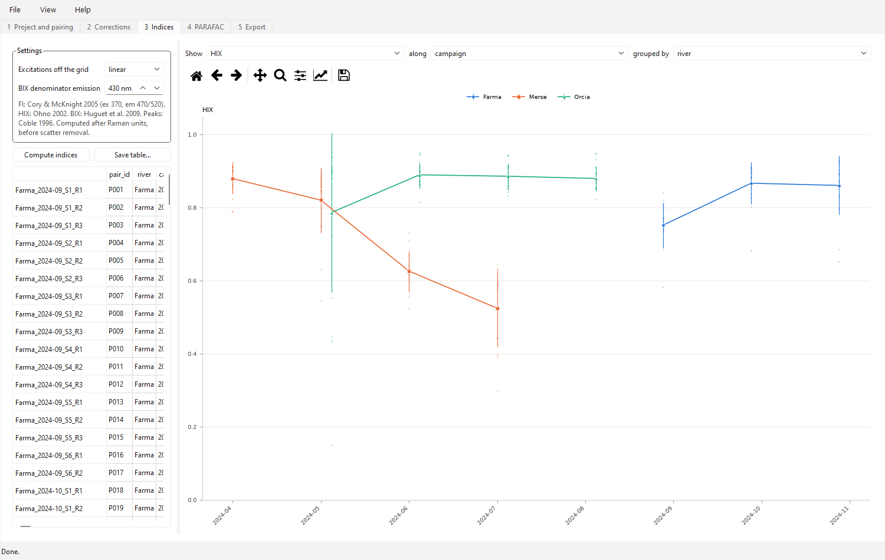
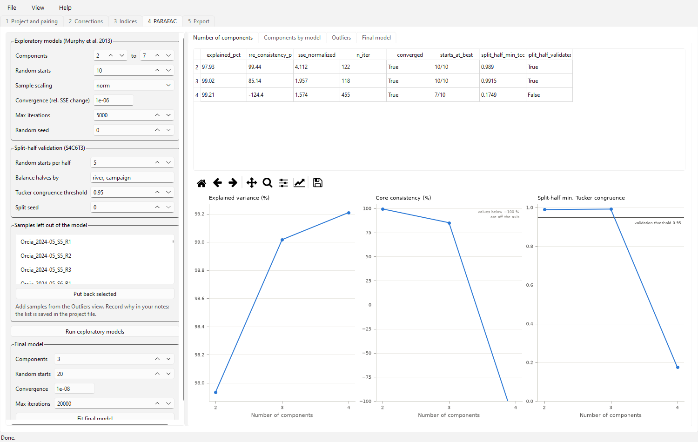
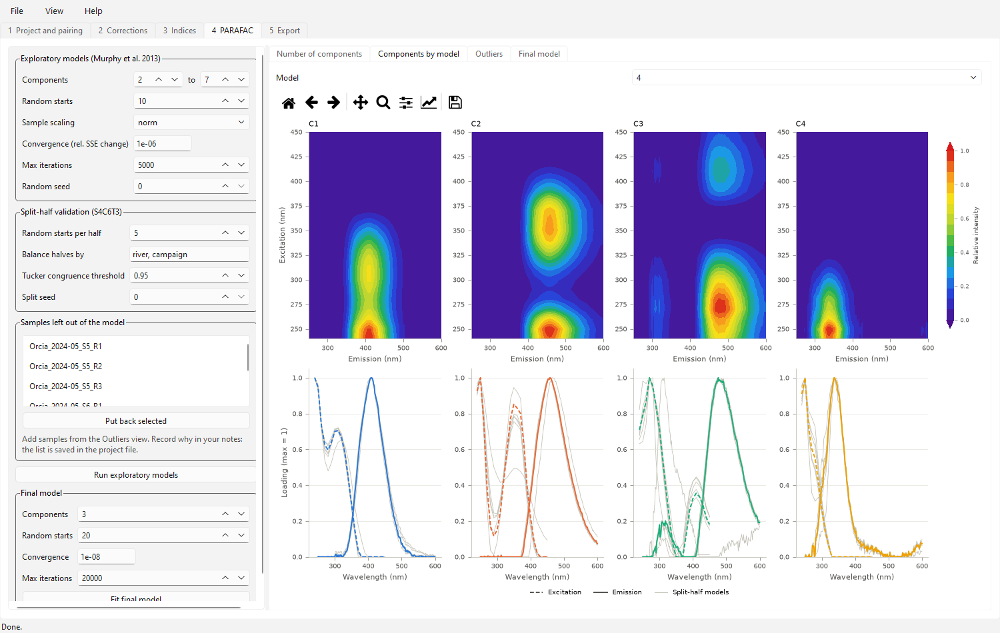
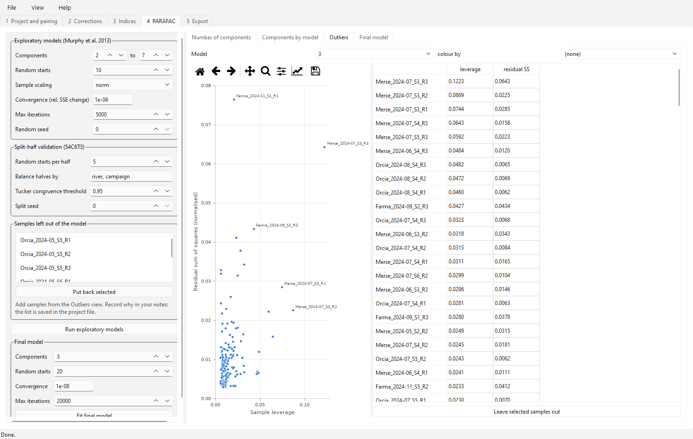
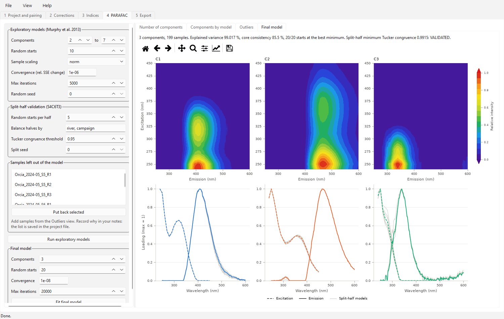
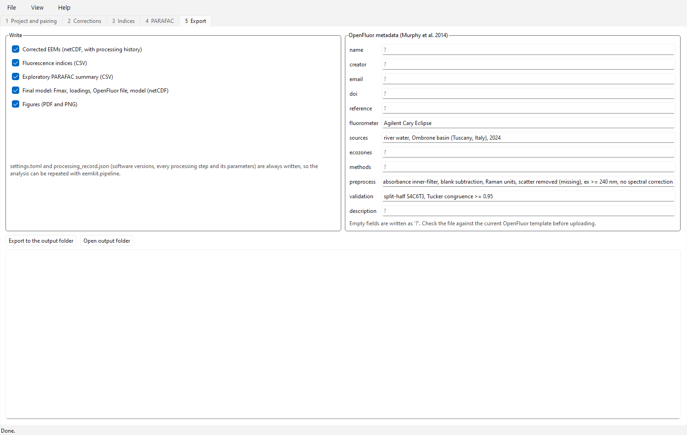

# Desktop application guide

How to use the eemkit desktop application to go from Cary Eclipse and Cary 60 CSV files to corrected EEMs, fluorescence indices and a validated PARAFAC model.

The screenshots show river-water samples from the Ombrone basin, Italy, 2024 (Polvani et al. 2026, [doi:10.1016/j.envpol.2026.127858](https://doi.org/10.1016/j.envpol.2026.127858)); the data and the project file are in the [ombrone-fdom](https://github.com/LowCostSensor/ombrone-fdom) repository.

The app is a front end to the eemkit library and does no calculations of its own. Every button calls the same functions as a script using `eemkit.pipeline`, and gives the same results: on the Ombrone data, the 3-component model fitted in the app has 99.017 % explained variance, 85.5 % core consistency and a split-half congruence of 0.9915, as in the scripted analysis.

Labels in this guide are written as they appear on screen, for example `Apply corrections`.

## Starting the app

### From Python

```bash
pip install "eemkit[gui]"
eemkit-gui
```

To open a project directly, pass the file as an argument:

```bash
python -m eemkit.gui path/to/project.toml
```

### The Ombrone example project

The [ombrone-fdom](https://github.com/LowCostSensor/ombrone-fdom) repository contains the raw CSV files and `config/ombrone_project.toml`, with the parameters used for the Ombrone analysis. Clone it, open the project with `File` → `Open project…` and go straight to step 3 of the [workflow](#the-workflow).

### Windows executable (no Python needed)

Each [release](https://github.com/LowCostSensor/eemkit/releases) has a zipped stand-alone build (about 160 MB unpacked): unzip it anywhere and run `eemkit.exe`. To build it yourself, see [Desktop application](gui.md#stand-alone-build).

!!! tip "If the executable closes at once"
    The reason is written to `eemkit-crash.log` in the temporary folder (`%TEMP%`).

## Five things to know

1. **A project is a settings file.** Saving the project writes a `.toml` file with every parameter and path, in the same format as `processing.toml`. It does not store results: they are recomputed from the file, or exported from tab 5.
2. **The data folder is read only.** The app never writes, renames or moves anything in it, and refuses to save a project, a pairing table or results there.
3. **No silent pairing.** Only rows of the pairing table with `include = yes` are used. Automatically drafted rows always start excluded.
4. **Results are never out of date.** When you change a parameter, the results that depended on it are discarded: for example, changing a scatter band width deletes the PARAFAC models already computed, which must then be refitted.
5. **Long computations run in the background.** A progress bar and a `Cancel` button appear at the bottom; cancelling takes effect when the current model fit ends. If a computation raises warnings (for example a model that did not converge), a `⚠ N warnings` button appears: click it and read them before using the results.

## The workflow

The five tabs follow the order of the analysis. Each step uses the result of the previous one.

1. **Choose the folders** (tab 1): data, pairing table, output. Or open an existing project.
2. **Prepare the pairing table** (tab 1): open it if it exists; otherwise scan the folder, draft the table, check and include the rows.
3. **Load the data** with `3. Check and load data`.
4. **Apply the corrections** (tab 2) and check a few samples in the preview.
5. **Compute the indices** (tab 3).
6. **Explore PARAFAC models** (tab 4), look at the diagnostics and the outlying samples, then fit the final model.
7. **Export** (tab 5) and save the project.

## 1 · Project and pairing

This tab decides which files are read and how they are paired.



*The Ombrone table loaded: 227 rows, 205 included. The message box at the bottom confirms that 205 samples were read, all with an EEM blank and absorbance.*

### The three paths

* `Data folder`: the folder with the instrument CSV files.
* `Pairing table`: the CSV file with the pairing. `Open…` opens an existing one.
* `Output folder`: where tab 5 writes the results. It cannot be inside the data folder.

### The buttons, in order

| Button | What it does |
| --- | --- |
| `1. Scan data folder` | Reads the first two lines of every CSV (subfolders included) and classifies it: Cary Eclipse 3-D EEM, Cary 60 absorbance, or not recognised. `.FDSW` and `.BSW` files are ignored. The result is in the `Files found` sub-tab; unused files, with the reason, are listed in the message box. |
| `2. Draft pairing from scan` | Proposes one row for every EEM that is not a blank (see below). If a table already exists, it asks before replacing it. |
| `Include selected rows` | Sets `include = yes` on the selected rows and marks them as checked (`pairing_status = checked`). Use it only after checking those rows. |
| `Exclude selected rows` | Sets `include = no`. |
| `Save pairing table` | Writes the table to the file in `Pairing table` (or asks for a new one). |
| `3. Check and load data` | Saves the table, checks that every file of the included rows exists and reads the data. The message box reports the samples read, wavelength ranges, how many have a blank and absorbance, and any warnings. |

### How the draft is made

* A file is taken as a **blank** if the sample or file name contains *blank*, *bianc*, *milli-q*, *MQ* or *ultrapure*.
* **Absorbance**: the absorbance file with the same sample name (ignoring case, spaces, `_`, `-` and `.`), preferring one in the same folder. If there are none, or more than one, the cell stays empty.
* **EEM blank** and **absorbance blank**: the only blank in the same folder. If there are two, none is chosen.
* Every choice, or the reason why none was made, is written in the `pairing_notes` column.

!!! warning "For the Ombrone data"
    Do not use the draft: `config/pairing.csv` is already curated by hand (including the exclusions of FARMA 62, FARMA DICEMBRE, FARMA 1 and 2). The draft is meant for a new dataset.

### Reading and editing the table

* Row colours: yellow = drafted automatically and not yet checked; grey = excluded (will not be read); white = included.
* **Double-click** a cell to edit it. In the file columns (`eem_file`, `eem_blank_file`, `abs_file`, `abs_blank_file`) a list opens with the files of the right kind found by the scan.
* The `Filter rows…` box filters on every column (for example `Merse_2024-07`). Clicking a column header sorts by that column.
* Extra columns (river, campaign, site, replicate, notes…) become sample metadata: you find them again in the indices and in the groupings.

## 2 · Corrections

Parameters on the left, preview on the right. The order of the steps is fixed: instrument spectral correction (optional), absorbance blank, inner-filter effect, blank subtraction, Raman units, scatter, crop.



*Orcia, June, site 6, replicate 2, after inner filter, blank and Raman units, in the Cary Eclipse colours (violet = low, red = high). The scale is capped at the fluorescence maximum, so the scatter bands appear saturated (red).*

### The parameters

| Box | Contents | Ombrone |
| --- | --- | --- |
| `Instrument spectral correction` | Excitation and emission correction factor files of the instrument (optional, see [below](#instrument-spectral-correction)). Empty = not applied. | not applied |
| `Inner filter` | Path length of the two cuvettes in cm. **Required**, with no default: while they are empty (red) the corrections do not run. Kothawala et al. 2013. | 1 and 1 |
| `Raman units` | Excitation and emission range of the Raman area of the blank; optional baseline subtraction. Lawaetz & Stedmon 2009. | Ex 350, Em 381–426, no |
| `Scatter removal` | Water Raman shift and width (below/above, in nm) of the four bands: first- and second-order Rayleigh and Raman. `Zeros below Rayleigh` sets to zero the region where emission is below excitation minus the offset (Thygesen et al. 2004). `Interpolate removed bands`: `no` keeps the bands as missing data, as PARAFAC needs; `em`, `ex` or `both` interpolate them. | 3400 cm⁻¹; 10/10, 8/8, 12/12, 10/10; zeros at 10 nm; no |
| `Crop` | Excitation and emission limits to keep. Empty = no limit. | Ex ≥ 240 |
| `Samples without blank or absorbance` | `error` stops and lists them; `drop` removes them; `keep` leaves them *uncorrected* (not recommended: corrected and uncorrected samples would be mixed). | error |

!!! note "Defaults"
    In a new project the scatter bands start at 10 nm, the eemR and staRdom default. It is a generic starting point: check it against the blanks in the preview before accepting it.

### Instrument spectral correction

Lamp, monochromators and detector do not respond equally at all wavelengths. When the Cary Eclipse records with *Corrected spectra* OFF, as for the Ombrone data, the EEMs contain this response: Raman units stay consistent among your samples, but indices such as FI cannot be compared with those from other instruments (Cory et al. 2010).

* `Excitation file` and `Emission file`: `Choose…` picks the file, `Clear` removes it. Both are needed, or neither.
* Format: two columns, wavelength (nm) and factor; header lines and `,` `;` tab or space separators are fine. The factors must cover the whole excitation and emission range of the EEMs and be positive.
* As soon as a file is chosen it is read, and the number of values, the range and the smallest and largest factor appear below it, so you see at once whether it is the right file.
* `Files contain`: `correction factors (multiply)` if the file holds correction factors (the EEMs are multiplied); `instrument response (divide)` if it holds the instrument response, for example a reference spectrum (the EEMs are divided).
* The correction is applied first, to samples and blanks. In the preview's `Step` menu, `Spectral correction factors` plots the factors actually applied; the summary under the plot gives the correction status.
* Data recorded with *Corrected spectra* ON are refused, so the correction is never applied twice.

!!! warning "Where the factors come from"
    eemkit ships no correction factors: they belong to one instrument and must be measured, for example with certified reference standards, or obtained from the instrument's service. None are available for the Ombrone data, so the correction is left empty.

### Applying and checking

* `Apply corrections` stores the parameters in the project and runs the chain. On the Ombrone data it takes about a second.
* `Sample` picks the sample, `Step` the step: `Raw sample`, `Raw blank`, `After inner filter, blank, Raman units`, `Corrected (scatter removed, cropped)`, `Spectral correction factors`.
* In the steps before scatter removal, the colour scale is capped at the fluorescence maximum; the title says so.
* Under the plot, a summary: spectral correction status, inner-filter factor over all cells (median and maximum), Raman area of the blanks with its CV, final grid and percentage of missing cells. On the Ombrone data: maximum factor 1.39, Raman area CV 3.1 %, 13.6 % missing cells.
* The matplotlib toolbar above the plot zooms and pans; the disk icon saves the image.

## 3 · Indices

FI (Cory & McKnight 2005), HIX (Ohno 2002), BIX (Huguet et al. 2009) and the Coble (1996) peaks, computed on the EEMs in Raman units, before scatter removal.



*HIX by campaign, grouped by river: mean ± standard deviation over sites and replicates, with the individual samples as faint points.*

* `Excitations off the grid`: how to handle excitations that were not measured (254, 275 and 312 nm on a 10 nm grid). `linear` interpolates between the two neighbouring scans; `nearest` uses the closest one; `exact` refuses.
* `BIX denominator emission`: emission of the BIX denominator (430 nm in Huguet et al. 2009).
* `Compute indices` computes the table; `Save table…` saves it as CSV.
* The plot is set with `Show` (which index), `along` (x axis, for example `campaign`) and `grouped by` (for example `river`). At most 8 groups, one colour each.

!!! warning "FI"
    Without the instrument's spectral correction, FI is about 2 and can be compared only with measurements on the same fluorometer.

## 4 · PARAFAC

Settings on the left, four views of the results on the right. Work in two stages: first the exploratory models, to choose the number of components, then the final model.

### Settings of the exploratory models

* `Components` from … to …: the range of components to try.
* `Random starts`: random initialisations per model; the best is kept.
* `Sample scaling`: `norm` scales every sample to unit norm before fitting, so that a few very intense samples do not dominate (Murphy et al. 2013); scores are then returned in Raman units.
* `Convergence` and `Max iterations`: 1e-6 is enough to explore; the final model has its own.
* `Split-half validation (S4C6T3)`: initialisations per half, columns used to balance the halves (`river, campaign` for the Ombrone), Tucker congruence threshold (0.95) and split seed.
* `Samples left out of the model`: samples excluded from the model. For the Ombrone, the 6 Orcia samples from May, sites 5 and 6, are already there. `Put back selected` returns them to the model.

`Run exploratory models` fits every model and its split-half validation. On the Ombrone data, 2–4 components with 3 initialisations took about 3.5 minutes; with the project settings (2–7 components, 10 initialisations) it takes tens of minutes.

### “Number of components” view



*One row per number of components, and below three separate plots: explained variance, core consistency and minimum split-half congruence with the 0.95 threshold.*

| Column | Meaning |
| --- | --- |
| `explained_pct` | Explained variance (%) of the scaled data. |
| `core_consistency_pct` | CORCONDIA (Bro & Kiers 2003): close to 100 for an appropriate model, collapses with too many components. |
| `sse_normalized` | Residual sum of squares. |
| `n_iter`, `converged` | Iterations of the best fit and whether it reached the tolerance. |
| `starts_at_best` | How many initialisations reached the same minimum: if few did, the solution is unstable. |
| `split_half_min_tcc`, `split_half_validated` | The minimum congruence between halves and whether it passes the threshold. |

A good candidate is validated by split-half analysis, has a high core consistency, initialisations that agree and components with sensible spectral shapes.

### “Components by model” view



*The components of the model chosen in the `Model` menu, here the 4-component model without the 6 Orcia samples, which was rejected. Under each EEM, the excitation (dashed) and emission (solid) loadings; the grey lines are the six split-half models. In C2 and C3 the grey lines diverge and C3 has two implausible excitation maxima: the signs of a model with too many components.*

### “Outliers” view



*Leverage against residuals for the chosen model, coloured by river. The table on the right sorts the samples by leverage.*

* A sample with **high leverage** drives the model on its own; one with a **high residual** is poorly explained.
* To leave one out: select it in the table and press `Leave selected samples out`. It moves to the list on the left and the models must be refitted.
* The list of excluded samples is saved in the project, the reason is not: write it down (for the Ombrone it is in a comment in `processing.toml`).

### The final model

In the `Final model` box set the number of components, initialisations (20), tolerance (1e-8) and maximum iterations, then press `Fit final model`. The model is fitted and validated again by split-half analysis.



*The final Ombrone model (20 initialisations, all at the same minimum). The line at the top gives explained variance, core consistency, initialisations at the minimum and the split-half verdict.*

## 5 · Export



*What to write on the left, OpenFluor metadata on the right; below, the list of files written.*

* Choose what to write with the check boxes; a result not yet computed is skipped and reported.
* Fill in the OpenFluor metadata you know (creator, email, DOI, reference, description). Empty fields become `?`; fields that follow from the model (units, number of samples, constraints, date, software) are filled automatically. The metadata are saved in the project.
* `Export to the output folder` writes the files; `Open output folder` opens the folder.

| File | Contents |
| --- | --- |
| `settings.toml` | Every setting used (always written). |
| `processing_record.json` | Software versions, every processing step with its parameters, sample list, model statistics (always written). |
| `corrected_eems.nc` | Corrected EEMs, netCDF, with the processing history. |
| `indices.csv` | Indices and peaks per sample, with the metadata. |
| `parafac_exploration.csv` | The “Number of components” table. |
| `parafac_3comp_fmax.csv` | Fmax of every component per sample, in Raman units. |
| `parafac_3comp_ex_loadings.csv` `parafac_3comp_em_loadings.csv` | Excitation and emission loadings. |
| `parafac_3comp_openfluor.txt` | File for OpenFluor. Check it against the current upload template before submitting it. |
| `parafac_3comp_model.nc` | The complete model. |
| `figures/` | Number-of-components diagnostics, components and leverage, as PDF and PNG, in the colours chosen in `View` → `EEM colours`. |

The `3` in the names is the number of components of the final model.

## Menus and saving

* `File` → `New project`, `Open project…`, `Save project` (Ctrl+S), `Save project as…`, `Quit`.
* An asterisk in the window title (`eemkit - project.toml *`) marks unsaved changes; on closing, the app asks whether to save them.
* Paths below the project file's folder are saved as relative paths, so a project can be moved together with its files.
* When a project is opened, its pairing table is loaded automatically; the data must be read again with `3. Check and load data`.
* `View` → `EEM colours` chooses the EEM colours (see below).
* `Help` → `About eemkit` shows the version, the methods and the library versions.

### EEM colours

Every EEM plot (correction preview, PARAFAC components, exported figures) uses the same scale, chosen in `View` → `EEM colours`:

* `Cary Eclipse (violet, blue, green, yellow, red)`, the default: violet for low values, then blue, green, yellow and red for high values, as in the instrument software's plots.
* `Single-hue blue (perceptually ordered, for print)`: white to dark blue.

The choice is saved in the project. The rainbow scale is handy for comparing with the instrument, but its jumps in hue (for example from green to yellow) look like boundaries that are not in the data; for published figures the blue scale is preferable (Crameri et al. 2020, *Nature Communications* 11, 5444).

## Repeating it from a script

The project file is enough to repeat the analysis without the app:

```python
from eemkit import pipeline

s = pipeline.load_settings("project.toml")
raw = pipeline.load(s, base="folder/of/the/project")
after_raman = pipeline.correct_until_raman(raw, s, base="folder/of/the/project")
corrected = pipeline.finish_corrections(after_raman, s)
indices = pipeline.compute_indices(after_raman, s)
ds = pipeline.parafac_input(corrected, s)
exploration = pipeline.explore(ds, s)
model, split = pipeline.fit_final(ds, s)
pipeline.export_results("results", s, corrected=corrected, indices=indices,
                        exploration=exploration, model=model, split=split)
```

A parameter without a default, such as the path length, stops the run with a message that names it. `base` locates the spectral correction files when they are given relative to the project.

## Common problems

| Message or situation | What to do |
| --- | --- |
| “Enter both cuvette path lengths” | Enter the two path lengths in tab 2 (1 cm for the Ombrone). |
| “Spectral correction needs both the excitation and the emission file” | Choose the other file too, or remove the chosen one with `Clear`. |
| “… factors cover … nm, grid needs … nm” | The factor file does not cover the whole EEM range and one that does is needed. Cropping does not help: the spectral correction is applied before cropping. |
| “cannot read” under a factor file | The file does not have two numeric columns (wavelength, factor). Check it in a text editor. |
| “Load the data first” / “Apply the corrections first” | A previous step is missing: follow the order of the tabs. |
| Pairing table error | The list gives the row and the problem (missing file, duplicate `sample_id`, invalid `include`). Fix it and reload. |
| “… sample(s) have no blank / absorbance” | Complete the table, or choose `drop` in `Samples without blank or absorbance`. |
| `⚠ N warnings` after PARAFAC | Read the warnings. “did not converge”: raise `Max iterations` and refit. |
| A tab's results have disappeared | You changed a parameter they depended on: compute them again. |
| The indices plot does not appear | The column chosen in `grouped by` has more than 8 groups: choose another. |
| “The data folder is read only” | Save the project, table or results outside the data folder. |
| The executable closes at start-up | Read `%TEMP%\eemkit-crash.log`. |

## Current limits

* Only the “ASCII with log” CSV files of the Cary Eclipse (3-D EEM) and Cary 60 (absorbance) are read.
* eemkit ships no spectral correction factors: they must be measured for each instrument.
* Cancelling a computation takes effect only when the current model fit ends.
* The interface is in English only.
* Results are not saved in the project: after reopening it they must be recomputed, or taken from the exported files.