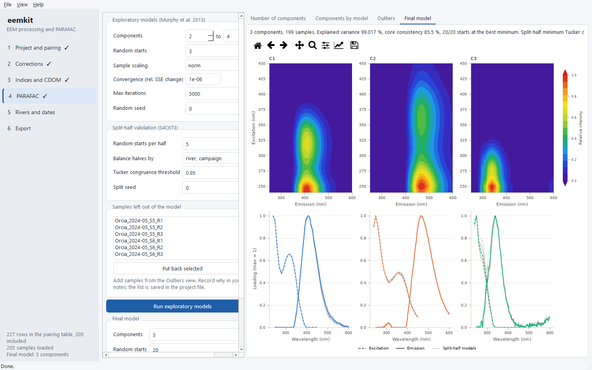

# eemkit

Python tools and a desktop application for fluorescence excitation-emission
matrices (EEMs) of dissolved organic matter: instrument import, corrections,
fluorescence indices and validated PARAFAC modelling, with every processing
step recorded so that an analysis can be repeated exactly.



## Principles

* **Nothing silent.** Samples, blanks and absorbance spectra are paired in an
  explicit table that you check; values that depend on the measurement (such
  as cuvette path lengths) have no defaults; corrections refuse to run twice
  or in the wrong order.
* **Every method has a source.** Each correction, index and diagnostic cites
  the publication it follows.
* **Provenance travels with the data.** Datasets are `xarray` objects that
  carry their metadata and the full processing history, and one settings file
  drives both scripts and the desktop application.

## Install

You need Python 3.11 or later (on Windows, tick *Add python.exe to PATH* when
installing it). The `[gui]` part adds the desktop application and the
figures:

```bash
python -m pip install "eemkit[gui]"
```

Then start the application with:

```bash
python -m eemkit.gui
```

For the library alone, leave out `[gui]` (or use `[plot]` for figures
without the application). A stand-alone Windows build of the application,
which needs no Python, is attached to each
[release](https://github.com/LowCostSensor/eemkit/releases).

To update to the latest release:

```bash
python -m pip install --upgrade "eemkit[gui]"
```

The development version, with changes not yet released, installs from GitHub:

```bash
python -m pip install --force-reinstall "eemkit[gui] @ https://github.com/LowCostSensor/eemkit/archive/refs/heads/main.zip"
```

`python -m pip show eemkit` tells which version is installed; the changes of
each version are in the
[changelog](https://github.com/LowCostSensor/eemkit/blob/main/CHANGELOG.md).

## Where to start

* [Quick start](quickstart.md): the whole chain from a script.
* [Desktop application guide](app-guide.md): the same chain without code.
* [Command line](cli.md): the same chain from a terminal, with an HTML
  report.
* [Instruments and file formats](instruments.md): Cary Eclipse, Aqualog,
  Fluoromax, Hitachi F-7000, Shimadzu and plain matrices.
* [Data model](data_model.md), [Corrections](corrections.md),
  [Indices](indices.md), [CDOM metrics](absorbance.md), [PARAFAC](parafac.md),
  [Rivers, sites and dates](campaigns.md), [Figures](plotting.md): how each
  step works and which publication it follows.
* [API reference](api.md).

## Validation

eemkit was compared with the R package staRdom 1.1.32 (Pucher et al. 2019) on
205 river-water samples from the Ombrone basin, Italy (Polvani et al. 2026):
corrected EEMs agree to a median relative difference of 2.2 × 10⁻⁴, FI, BIX
and Coble peaks to machine precision, HIX to 3 × 10⁻⁴, and the 3-component
PARAFAC models have Tucker congruence ≥ 0.999 for every loading. Against
drEEM 2.26.03 (MATLAB; both its engines, N-way and parafac3w) the model has
Tucker congruence ≥ 0.9999, the same explained variance, and core
consistency within 0.1 %. Scripts and report:
[ombrone-fdom](https://github.com/LowCostSensor/ombrone-fdom).

## Citation and license

Cite eemkit as *Cirrone, R. G. eemkit: EEM processing and PARAFAC modelling
of dissolved organic matter fluorescence. Zenodo.
[doi:10.5281/zenodo.23982732](https://doi.org/10.5281/zenodo.23982732)*,
together with the methods you used. This DOI always points to the latest
version; each release has its own DOI on the Zenodo page (0.2.0:
[10.5281/zenodo.24015024](https://doi.org/10.5281/zenodo.24015024); 0.1.0:
[10.5281/zenodo.23982733](https://doi.org/10.5281/zenodo.23982733)). Full
metadata:
[CITATION.cff](https://github.com/LowCostSensor/eemkit/blob/main/CITATION.cff). eemkit is free software under the GNU General Public License v3.0 or
later.
